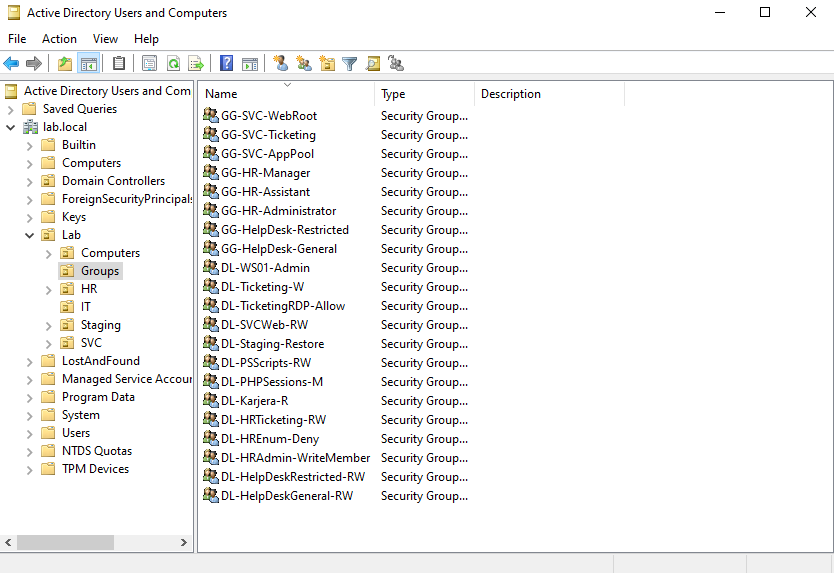
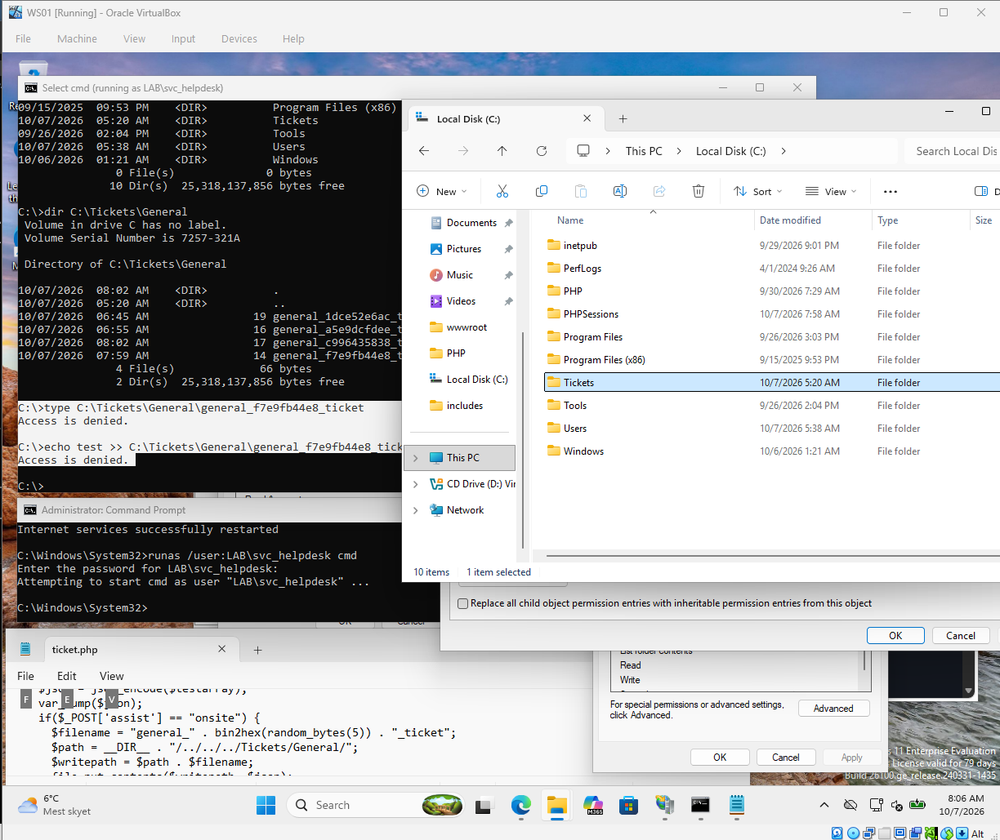
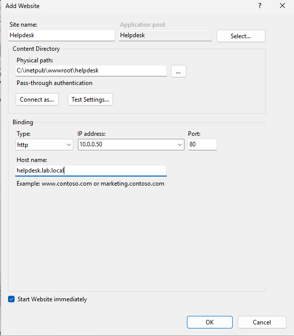
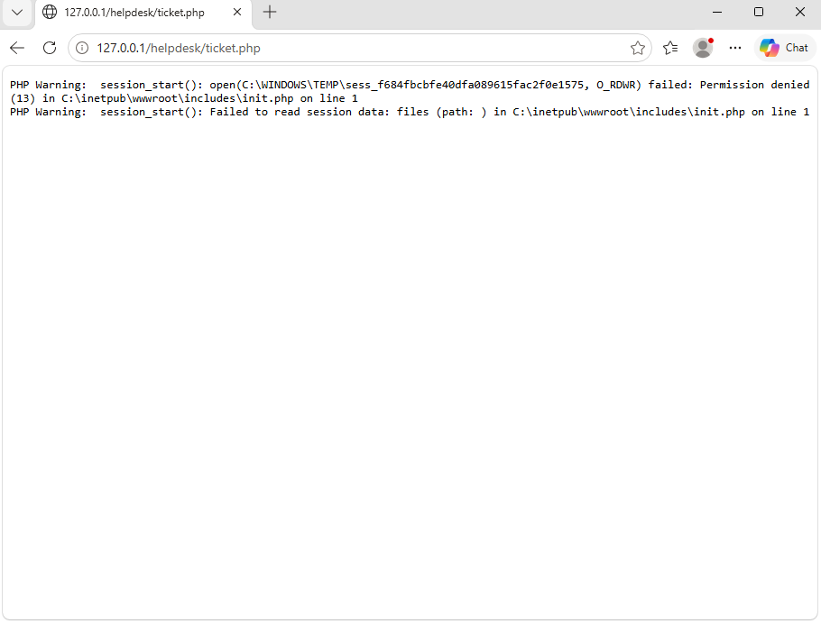
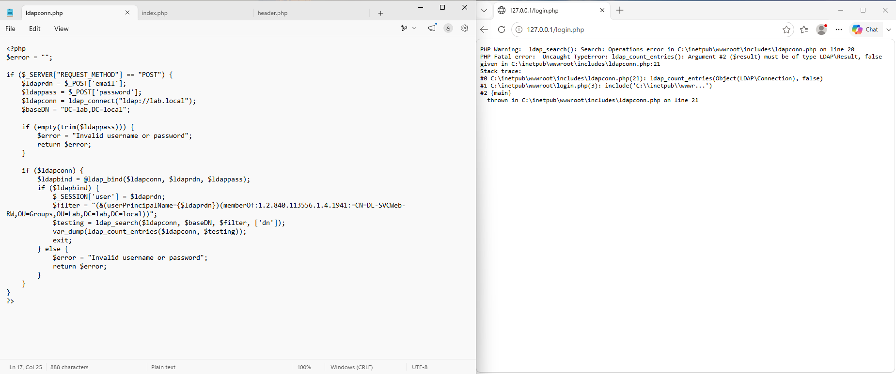
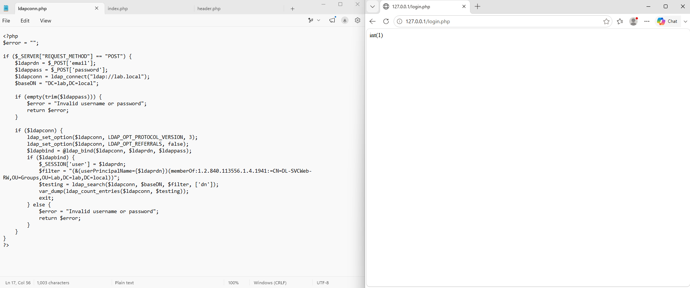
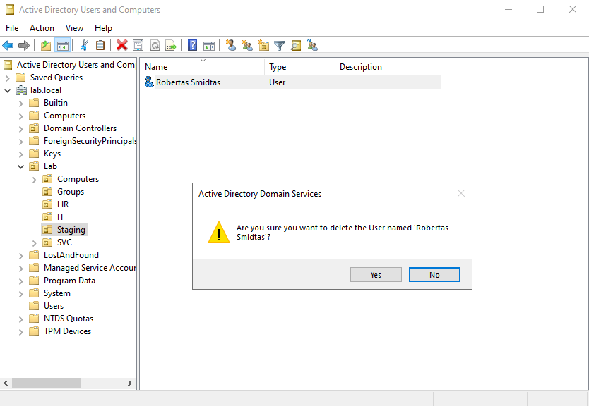
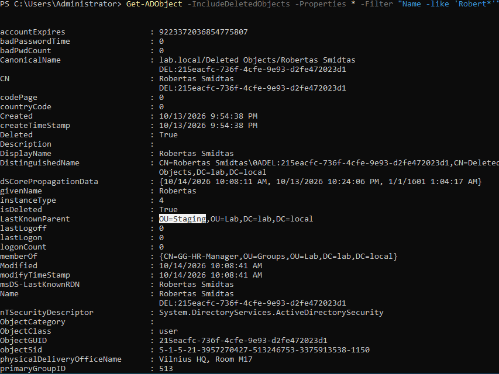
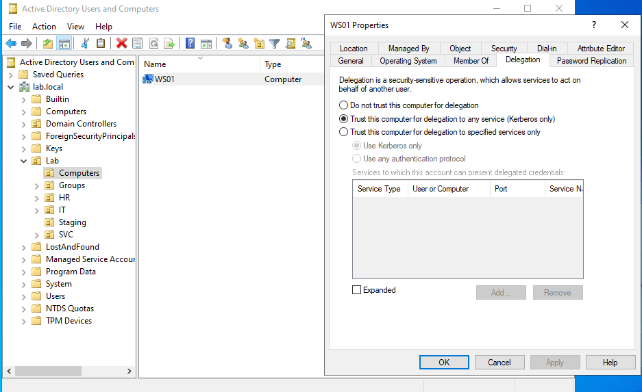

# Building the lab

## Scenario Help Desk: Restricted Queue

I figured if I was testing attacks that I've done before, why not implement more realism since I set up IIS and PHP already? By now, the homelab scope creep went from testing IT tasks to creating a machine you'd see on a CTF. The scenario was going to be built on what I learned from HTB.

## Remote file inclusion idea

As I am currently learning PHP, I focused on how unsanitized user input passed into `include` can lead to Remote File Inclusion.

## Scenario Help Desk: AGDLP and SoD

At first, I used a standard IT, HR, SVC structure and linked the GPO to `Lab/Computers`. But as I realized that I would need to divide HR roles as well, I looked into AGDLP.

I had to redo my standard "HR" and "IT" roles because my scenario required Help Desk separated by tier at first, as my idea revolved around getting your ticket escalated as a way to exemplify privilege escalation. But then I moved towards a general/restricted setup, as HR deals with sensitive files while IT has to follow strict protocols to ensure they are handled by trusted staff.

I created a ticket share folder, isolated LDAP for HR so service accounts were invisible (can still query with Kerbrute, rpcclient, `GetADUsers.py`), restricted SAM (restrict BloodHound graphing, finding LSASS credential dump targets), and moved `LAB/IT` to `RDP-Workstations-Allow`. I temporarily disabled these features for now, so that the focus would be on the vulnerabilities, while hardening was saved for part 2.

The standardized naming convention is as follows:
- `GG-[Department]-[Role]`
- `DL-[Resource]-[AccessLevel]`
## Current structure

**Global Groups:**
- `GG-HR-Administrator`
  - `k.lilija`
- `GG-HR-Manager`
  - `s.robertas`
- `GG-HR-Assistant`
  - `v.henrikas`
- `GG-HelpDesk-Restricted`
  - `d.audra`
- `GG-HelpDesk-General`
  - `b.vytas`
- `GG-SVC-Ticketing`
  - `svc_helpdesk`
- `GG-SVC-WebRoot`
  - `svc_skyrius`
- `GG-SVC-AppPool`
  - `svc_helpdesk`
  - `svc_skyrius`

**Domain Local groups:**
- `DL-WS01-Admin`
  - `GG-HR-Administrator`
- `DL-HRAdmin-WriteMember`
  - `GG-HR-Manager`
- `DL-HRTicketing-RW`
  - `GG-HR-Administrator`
  - `GG-HR-Assistant`
  - `GG-HR-Manager`
- `DL-Staging-Restore`
  - `GG-HR-Administrator`
  - `GG-HR-Assistant`
  - `GG-HR-Manager`
- `DL-TicketingRDP-Allow`
  - `GG-HelpDesk-Restricted`
  - `GG-HelpDesk-General`
- `DL-PSScripts-RW`
  - `GG-HelpDesk-Restricted`
- `DL-HelpDeskRestricted-RW`
  - `GG-HelpDesk-Restricted`
- `DL-HelpDeskGeneral-RW`
  - `GG-HelpDesk-General`
- `DL-HREnum-Deny` **(Temporarily removed)**
  - `GG-SVC-AppPool`
- `DL-PHPSessions-M`
  - `GG-SVC-WebRoot`
  - `GG-SVC-Ticketing`
- `DL-Ticketing-W`
  - `GG-SVC-Ticketing`
- `DL-SVCWeb-RW`
  - `GG-SVC-WebRoot`
  - `GG-SVC-Ticketing`
- `DL-Karjera-R`
  - `GG-SVC-Ticketing`



### Ticket share ACLs

- `C:\Tickets\` INHERIT OFF, `DL-Ticketing-W`: Write (Subfolders only)
  - Administrators + `SYSTEM`: Full control (This folder, subfolders and files)
  - `DL-Ticketing-W`: Write (Subfolders only)
  - `DL-HelpDeskGeneral-RW`: List folder contents (This folder only)
  - `DL-HelpDeskRestricted-RW`: List folder contents (This folder only)
  - `DL-HRTicketing-RW`: List folder contents (This folder only)
- GENERAL: INHERIT ON, `DL-HelpDeskGeneral-RW`, `DL-Ticketing-W`
- RESTRICTED: INHERIT ON, `DL-HelpDeskRestricted-RW`, `DL-Ticketing-W`
- HR: INHERIT OFF, `DL-HRTicketing-RW`



### php.ini

`php.ini` **(development as of now)**
- `display_errors` On.
- `error_log = syslog` commented.
- I set `fastcgi.impersonate = 0` for IIS login in `php.ini` because the default user uses `IUSR` to write to files, instead of my application pool identities. `IUSR` has zero tenant isolation so it can write to both applications.
- `extension=ldap` and `extension_dir = "C:\PHP\ext"` uncommented so it would find `php_ldap.dll`.
- I set `session.save_path` to `C:\PHPSessions`.
- Restarted with `iisreset` to clear default in-memory sessions.

## Scenario Help Desk: Tickets

I went to Sites, Default Web Site to the helpdesk folder and chose Convert to Application, with Helpdesk as the app pool. The `DL-WebRoot-R` permission meant that they would only read the file but it would also separate the ticket and site app pool, so that `svc_skyrius` runs Skyrius, but `svc_helpdesk` forwards the tickets. Then I set `DL-HRTicketing-RW` and `DL-HelpDesk-RW` outside the `wwwroot` to restrict the actual ticket share away from `svc_helpdesk`.



Then I put a new session folder `C:\PHPSessions` and gave `DL-WebRoot-R` modify permissions. At this point I had to rename a lot of AGDLP structures, so I made several changes such as:

- `DL-HelpDesk-RW` split into `DL-HelpDeskGeneral-RW` and `DL-HelpDeskRestricted-RW` so that each of them could write into their own folder.
- Instead of placing HR and SVC together in `DL-HRTicketing-RW`, I created `DL-Ticketing-W`, so it could write tickets but not read or modify them.
- `DL-WebRoot-R` moved to `DL-SVCWeb-RW` instead of adding `DL-PHPSessions-R`, as I would avoid group bloat.

LDAP treats a bind with a username and an empty password as an anonymous login, called an "unauthenticated bind" in RFC 4513. The server reports it as a success, so PHP would create a valid session without a password.
`empty(trim($ldappass))`
I had to trim the password then check if it is empty, rather than relying on AD or LDAP to reject it. Other protocols like SSH or Kerberos would automatically reject it, which is a common source of confusion.

### d.audra

I wanted to create a distinct password for `d.audra`. I used this command to check for every type of character, which displayed `^M`, the carriage return, before each line break, then stripped it in-place, and overwrote the file. Finally, I filtered for passwords that begin with an uppercase letter, followed by 15 letters of any case, and ending in 3 digits, which would make the password 19-length.

```
cat -A
sed -i 's/\r$//' LT-Top100.txt LT-Top10k.txt LT-Top500k.txt
grep -P '^[A-Z][A-Za-z]{15}\d{3}$' LT-Top500k.txt
```

Her password was set to `Tikrasvartotojas123`. I started creating the ticket system and then I faced a bug with `mkdir`, but since Windows doesn't allow `:` in file or folder names and I tried to use `date(Y-m-d H:i:s)`, it should have instead been set to `date(Y-m-d_H-i-s)`. Later on, I changed this to `date(Ymd)`, as it would be easier to read, but also for sorting whenever the automated ticket batch job ran.

I had difficulty with magic bytes as I used `getimagesize` to stop the upload. Then I started testing different ntlm_theft payloads and I eventually found this (I intentionally ignored all Word and Excel documents, as I didn't install a Microsoft 365 license).
- `all-(url).url` WORKED ON CLICK
- `all.wax` WORKED ON CLICK (needs to use the default video player, more work, e.g. what if they use a different one?)
- `all.theme` WORKED ON CLICK (doesn't work a second time)
- `all.htm` WORKED ON CLICK (doesn't work a second time)
- `all.asx` WORKED ON CLICK

I decided to go with `all-(url).url` as it would just throw a generic error such as "Windows cannot access `\\10.6.6.100\leak\leak.html`. Contact your network administrator". The other ones would be dependent on the default video player, or too obvious to the user.

I thought about suppressing the SMB error, but then it would require the actual share to be hosted. Two important things first:
- Responder already poisons SMB on port `445`, so it is taken. impacket's smbserver can do both.
- In most cases, the user wouldn't suspect the `.url` file if it was dressed up, yet the share would initiate the SMB connection, which would be a richer event to capture.

However, even if I chose not to share the file, the failed SMB connection would still get logged. Network sensors such as Flow/NDRs see it on the wire, while Sysmon logs it on the host that made the connection (Event ID 3). In my architecture, I use centralized sensors where `DC01` and `WS01` forward logs, as the `WS01` machine sort of works like the help desk workstation. In other fully or partially distributed models, the network sensors would be placed on the important assets facing externally to the organization, so they would miss the event, as the connection stays internal. Sysmon on `WS01` would still catch it. For now, I decided not to suppress the error.

I wrote a new PowerShell script called `audra.ps1`, placed it in `PSScripts`, and then created a scheduled task named `audra`, checked `Runs whether user is logged on or not` and left `Do not store password` unchecked. I also synchronized my date on the attack VM with the domain controller using `ntpdate -u 10.0.0.10`. I created a GPO named `Audra Batch` and put `DL-HelpDeskRestricted-RW`, `DL-SVCWeb-RW`, `Administrators`, `Backup Operators`, `Performance Log Users`, `IUSR` in `Log on as a batch job`, as it is disabled by default. Finally, I used `powershell -NoProfile -ExecutionPolicy Bypass -File "C:\PSScripts\audra.ps1"`, so that it skips loading profile scripts to return the same result, gives a faster start and avoids errors.

Script: [`scripts/audra.ps1`](scripts/audra.ps1)

## Karjera

To make the lab similar to something that I saw in the wild, I installed URL Rewrite for IIS from `https://www.iis.net/downloads/microsoft/url-rewrite`. Then in IIS Manager, I added the "Request blocking" rule to match the pattern `/cv`.

## Scenario Help Desk: BALA
I chose this because it sounds similar to BOLA, and because rain leads to bala (Lithuanian: puddle).

After finishing the ticket system, I started working on the `lookup.php` for the LDAP search. I ensured that `svc_skyrius` and `svc_helpdesk` do not have access to `ticket.php` or `lookup.php`. But when I started adding a third user, I realized my query got quite long, and that looking up if a group was authorized would be the better approach.
```
<?php if ($user !== "svc_skyrius@lab.local" && $user !== "svc_helpdesk@lab.local" && $user !== "b.vytas@lab.local"): ?>

```
The only issue is that the user would still have authorization until the session expired or they logged out. The service users could delete them in `C:\PHPSessions` manually, or wait for them to expire.



I also faced an error where PHP would return `ldap_search(): Search: Operations error`. This happens because PHP talks to the server with LDAPv2, and if it doesn't hold the entry, then it tries to follow the referral pointer, where it might attempt an anonymous bind. The fix is to set it to LDAPv3 and turn referrals off:
```
ldap_set_option($ldapconn, LDAP_OPT_PROTOCOL_VERSION, 3);
ldap_set_option($ldapconn, LDAP_OPT_REFERRALS, false);
```





A `DN` is made up of a sequence of `RDNs`, such as `CN`, `OU`, and `DC`, from the specific entry up to the root. For `d.audra`, it looks like this:
```
CN=Audra Degutyte,OU=IT,OU=Lab,DC=lab,DC=local
```
When an LDAP server receives a request for a `DN` it doesn't hold, but knows where it exists, it redirects the client there.

I found out that attackers could set up a rogue server or poison DNS/ARP to manipulate the referral URI so it points to them instead. Once the client connects, it could leak plaintext credentials (`ldap://`), NTLM authentication tokens, or trigger Java JNDI deserialization. You might have heard of Log4j, which also comes from the same family. However, I chose to explore another escalation vector from `d.audra` to `v.henrikas`; namely LDAP injection. Her duties as a Help Desk Restricted staff are to look up HR personal information. If the input is not sanitized, LDAP injection can occur, leaking sensitive data.

To extract the membership, I set the `(groupType:%s:=2)`, but this would only give me the global group:
```
var_dump($ldapGroups);
array(1) { [0]=> string(22) "GG-HelpDesk-Restricted" }
```

Instead of bit type 2, I could use `(groupType:%s:=4)` to extract every single domain local group:
```
var_dump($ldapGroups);
array(3) { [0]=> string(12) "DL-RDP-Allow" [1]=> string(24) "DL-HelpDeskRestricted-RW" [2]=> string(15) "DL-PSScripts-RW" }
```

The groups are extracted through nesting the `member` attribute, so it follows every hop no matter what scope the ones in between have:
```
(&(groupType:1.2.840.113556.1.4.803:=4)(member:1.2.840.113556.1.4.1941:=$userDN))", ['dn'])
```
Other `groupType` attributes like 1 and 8 refer to system created or universal scopes respectively. You can also have 3 which is a system-created global group.

Now it's easier to apply authorization rules via `$_SESSION['groups']`, instead of each individual `$_SESSION['user']`. I renamed `DL-RDP-Allow` to `DL-TicketingRDP-Allow` to avoid group bloat, as whoever handles tickets needs RDP to help users.

At some point I needed to save the service account password during the LDAPBind to BALA. I had an existing entry for `C:\PHP\php-cgi.exe` with no environment variable, so I added another one with the `HELPDESK_LDAP_PASS` variable. To keep PHP from leaking the password into `svc_skyrius`'s app pool, I had to ensure the server node (`WS01`) does not use the new entry. I used a trick where I put `C:\PHP\php-cgi.exe|-c C:\PHP\php.ini` in the helpdesk node, so that the entry would be unique and get picked up by IIS.

I went ahead and started with BALA. Since I wanted faces, I installed Aseprite as I had previously thought of making a 2D game, which was later scrapped. At least it comes in handy now. I built `C:\aseprite\build\bin\aseprite.exe` with:
- Visual Studio Community 2022 with "Desktop development with C++" and the Windows 10.0.26100.0 SDK. 
- CMake and Ninja.
- Skia aseprite-m124, prebuilt, from Aseprite's own Skia releases.

I started drawing and it ended up looking like Robertas Smidtas, so I reused his face shape and created a Guest version of it. After I created a portrait for each character, I set up the images in AD for each user:
```
Set-ADUser d.audra -Replace @{thumbnailPhoto = [byte[]](Get-Content C:\Team\audra.png -Encoding Byte)}
```
I set up synthetic attributes as well, with email and phone numbers in the `555-0100` to `555-0199` range. Once BALA was finished, I put `v.henrikas`'s password in the `info` attribute. To find his password, I would have to do a blind LDAP injection and use the results as an oracle.

Afterwards, I had to restrict the `info` attribute so that the LDAP injection stage would work, otherwise someone could query `bloodyad -H 10.0.0.10 -u d.audra -p 'Tikrasvartotojas123' get object v.henrikas --attr info` and read it that way. `svc_bala` was created with a password length of 50 and used as the account that binds to BALA. Then I denied Read personal information for `DL-SVCWeb-RW`, `DL-TicketingRDP-Allow` and `DL-Staging-Restore`.

## s.robertas

I decided to keep Robertas Smidtas as an additional step for the BALA system, where someone would have to reanimate his account in order to get `GenericWrite`, rather than directly from `v.henrikas`. He was the previous HR manager, got fired and then deleted, so I created a new `OU` called `Staging`, gave `v.henrikas` `Reset Password` and `Create User Objects` (Custom task -> only following objects -> user objects -> created selected objects -> general -> write, inside the GUI) on `Staging`, Reanimate Tombstone on the domain root, and List contents/Read property/Write property on deleted objects.
```
dsacls "CN=Deleted Objects,DC=lab,DC=local" /takeownership

dsacls "CN=Deleted Objects,DC=lab,DC=local" /g LAB\DL-Staging-Restore:LCRPWP
```

Enabled Recycle bin and raised the lifetime of the deleted objects as it is set to 180 days by default.
```
Enable-ADOptionalFeature 'Recycle Bin Feature' -Scope ForestOrConfigurationSet -Target lab.local

Set-ADObject "CN=Directory Service,CN=Windows NT,CN=Services,CN=Configuration,DC=lab,DC=local" `
  -Replace @{'msDS-deletedObjectLifetime'=3650}
```

Set `DL-HRAdmin-WriteMember` in the Security tab of `GG-HR-Administrator` with Read/Write.

## k.lilija

Autologon for `k.lilija` to store her LSASS in memory, can be dumped via `sekurlsa::logonpasswords` or `lsadump::secrets`.
```
.\Autologon64.exe k.lilija LAB "V0lkw1n@v0n*Na4mb4rg!zu(Winterstatten)@" /accepteula
```

"Managed By" is one of the most common sources of accidental privilege escalation in Active Directory. When an audit shows an edge with `AddMember`, it's often unexplainable. `s.robertas` is an HR Manager in charge of `GG-HR-Administrator` with "Manager can update membership list". This allows him to add himself to the group, and dump Lilija's LSASS password as he is now a local admin.

Once Robertas was set up, I deleted his user and double-checked:
```
Get-ADObject -IncludeDeletedObjects -Properties * -Filter "Name -like 'Robert*'"
```
Field returns `isDeleted: True` with canonicalName `lab.local/Deleted Objects/Robertas Smidtas`.





Before doing the LSASS dump, I had to clear up the credentials, as during testing I used `LAB\Administrator` to edit privileges as `labadmin`. I installed Sysinternals psexec to get `NT AUTHORITY\SYSTEM`, and deleted the cache.
```
psexec -s -i cmd.exe
reg delete "HKLM\SECURITY\Cache" /f
```
Lilija's secrets still live in `HKLM\Security\Policy\Secrets`, which are decrypted using the LSA key. Because the local administrator has `SYSTEM`, it can use the bootkey from the SYSTEM hive to decrypt the LSA secrets.

Even though Winlogon has the password in the cache, it still needs the DC or a cached verifier to confirm it is correct. I reran the autologon script and booted up `WS01` so it would store her DCC2.

## Unconstrained delegation

The HR-Administrator `k.lilija` ended up ticking "Trust this computer for delegation to any service" on the `WS01` computer object, conflating the app's identity with the host it runs on. As I saw previously, `php.ini` had `fastcgi.impersonate = 1`, which ignored the application pool identity until I later set it to 0. The tick was eventually forgotten and never turned off by `k.lilija`. This mirrors the real fork that I hit when I set up `svc_skyrius` and `svc_helpdesk`, but with an actual misconfiguration.


