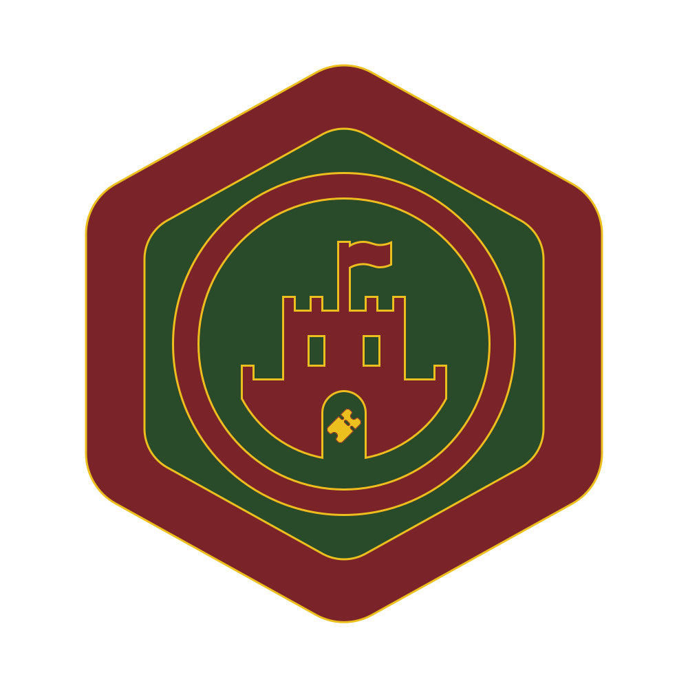
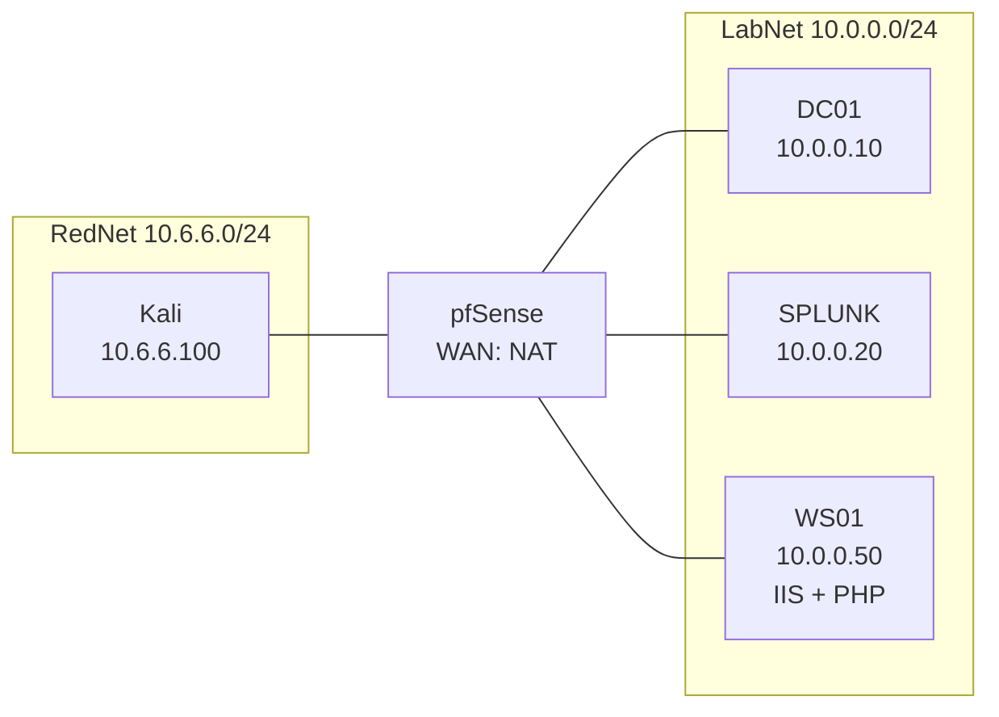

  

Skyrius is an intentionally vulnerable Active Directory homelab. Built with PHP on IIS (FastCGI), AGDLP, pfSense and Splunk, it covers a full attack chain from RFI to DCSync.

Using Microsoft's best practice Accounts Global Groups Domain Local Groups Permissions (AGDLP) ensures that access remains auditable, scalable and secure. Skyrius, a fictional Lithuanian web hosting company, runs its Internet Information Services (IIS) webserver using the FastCGI module to handle tickets in PHP, both remotely and on-site. The Base Active Lookup Agent (BALA) handles sensitive personal information, only available to authorized staff.

Intentionally vulnerable, the lab illustrates several attacks such as SAN disclosure, kerberoasting, password reuse, file upload bypass via magic bytes, remote file inclusion, blind LDAP injection, attribute enumeration, recycle bin abuse, DACL abuse, LSA secrets dumping, unconstrained delegation coercion harvesting, DCSync and pass-the-hash. 

Splunk captures logs from `DC01` and `WS01`, but the attacker cannot reach Splunk as there is a pfSense firewall in place. Disabling LLMNR and NBT-NS will be one of the first hardening steps alongside logging the intrusion, but it could also reveal a blind spot in the wildcard DNS permissions rules. 

## Contents

The lab is currently in progress (1/3).

- [Overview](#overview)
  - [Lab layout](#lab-layout)
  - [Tools](#tools)
  - [Write-up](#write-up)
  - [Repository](#repository)
- [Building the lab](BUILD.md)
  - [Scenario Help Desk: Restricted Queue](BUILD.md#scenario-help-desk-restricted-queue)
  - [Remote file inclusion idea](BUILD.md#remote-file-inclusion-idea)
  - [Scenario Help Desk: AGDLP and SoD](BUILD.md#scenario-help-desk-agdlp-and-sod)
  - [Current structure](BUILD.md#current-structure)
  - [Scenario Help Desk: Tickets](BUILD.md#scenario-help-desk-tickets)
  - [Karjera](BUILD.md#karjera)
  - [Scenario Help Desk: BALA](BUILD.md#scenario-help-desk-bala)
  - [s.robertas](BUILD.md#srobertas)
  - [k.lilija](BUILD.md#klilija)
  - [Unconstrained delegation](BUILD.md#unconstrained-delegation)
- [The site](MISCONFIG.md)
  - [Skyrius Misconfig](MISCONFIG.md#skyrius-misconfig)
- [Attack chain](ATTACK_CHAIN.md)
  - [Introduction: web hosting company](ATTACK_CHAIN.md#introduction-web-hosting-company)
  - [Footprinting: information disclosure via certificate SANs](ATTACK_CHAIN.md#footprinting-information-disclosure-via-certificate-sans)
  - [Remote File Inclusion: capturing svc_skyrius's NetNTLMv2 credentials via Responder](ATTACK_CHAIN.md#remote-file-inclusion-capturing-svc_skyriuss-netntlmv2-credentials-via-responder)
  - [Password Reuse: b.vytas's access to tickets leads to a file upload bypass via magic bytes](ATTACK_CHAIN.md#password-reuse-bvytass-access-to-tickets-leads-to-a-file-upload-bypass-via-magic-bytes)
  - [BALA: Blind LDAP injection with password leaking through the info attribute](ATTACK_CHAIN.md#bala-blind-ldap-injection-with-password-leaking-through-the-info-attribute)
  - [Deleted Objects: restoring s.robertas and resetting his password](ATTACK_CHAIN.md#deleted-objects-restoring-srobertas-and-resetting-his-password)
  - [Unconstrained Delegation: dumping k.lilija's password in plaintext](ATTACK_CHAIN.md#unconstrained-delegation-dumping-klilijas-password-in-plaintext)
  - [Unconstrained Delegation: full DC compromise](ATTACK_CHAIN.md#unconstrained-delegation-full-dc-compromise)
- [Lessons learned](#lessons-learned)
- [Conclusion](#conclusion)

## Overview

### Lab layout
- **pfSense WAN:** NAT, DHCP
- **pfSense LAN:** `10.0.0.1 /24`
- **pfSense OPT1:** `10.6.6.1 /24`
- **DC01:** `10.0.0.10`, gw `10.0.0.1`, DNS `127.0.0.1` (LabNet)
- **SPLUNK:** `10.0.0.20`, gw `10.0.0.1`, DNS `10.0.0.10` (LabNet)
- **WS01:** `10.0.0.50`, gw `10.0.0.1`, DNS `10.0.0.10` (LabNet)
- **ATTACK:** `10.6.6.100`, gw `10.6.6.1`, DNS `10.0.0.10` (RedNet)

### Tools

- **Recon:** nmap, ffuf, curl, CeWL
- **Credentials:** Responder, ntlm_theft, hashcat, NetExec (nxc)
- **AD:** bloodyAD, BloodHound CE (bloodhound-ce-python), Impacket (`GetUserSPNs.py`, `secretsdump.py`, `ticketConverter.py`)
- **Delegation:** Rubeus (through go-buena-clr), krbrelayx, PetitPotam
- **Access:** evil-winrm
- **Scripting:** Python (requests)

### Write-up

The write-up is split into three pages:

- [Building the lab](BUILD.md): how I built the scenario, the AGDLP structure, the ticket share ACLs, `php.ini`, the help desk tickets, Karjera, BALA, `s.robertas`, `k.lilija` and the unconstrained delegation.
- [The site](MISCONFIG.md): the Skyrius source code, what inspired it, and the Skyrius Misconfig list of intentional misconfigurations that do not break the chain.
- [Attack chain](ATTACK_CHAIN.md): the full chain from the certificate SANs to pass-the-hash on `DC01`.

### Repository

- [`ws01/wwwroot/`](ws01/wwwroot/): the Skyrius and help desk source code
- [`ws01/Karjera/`](ws01/Karjera/): the Karjera site, the CVs and the `web.config` files behind the `/cv/` directory listing
- [`ws01/Tickets/`](ws01/Tickets/): example tickets from the General and Restricted queues
- [`scripts/`](scripts/): `attributefuzz.py`, `attributes.txt`, `audra.ps1`
- [`screenshots/`](screenshots/): lab screenshots; some of them were omitted in the write-up, so take a look!
- [`team/`](team/): the BALA portraits, hand-drawn in Aseprite

## Lessons learned

#### IIS case-insensitivity
During fuzzing, I noticed strange behavior where the wordlist would duplicate `CV` and `cv`. I expected that `.php` would find the actual file, but they ended up being false positives. This is because IIS inherits case-insensitivity from NTFS. Using lowercase wordlists can help, but it can also be useful to find out whether a server is a Windows machine, all without `nmap -O`. 

#### LDAPv2 referral error
`lookup.php` was supposed to return the users, but instead it threw an `Operations error`. PHP uses LDAPv2 and follows the referral, which can drop the authentication credentials and attempt an anonymous bind. I learned that I should set protocol version to 3 and turn referrals off.

#### krbrelayx NTLM fallback
The `DC01$` TGT should've been captured in krbrelayx on Kali, but `Unsupported MechType 'NTLMSSP'` appeared instead. IPs do not have an `SPN`, so there are no Kerberos tickets available and Windows falls back to NTLM. I learned that it's not always DNS, and that coercion requires a valid FQDN and an existing DNS record.

#### Kerberos clock skew
I was about to use secretsdump on `DC01`, but it ended up outputting `[*] Cleaning up...`. The clock was 538 seconds off, higher than the permitted 5-minute window. I learned that this was to prevent replay attacks, and that running `ntpdate -u` should be one of the first troubleshooting steps in Active Directory.

## Conclusion

The surprising part about building a lab compared to playing one is the number of side effects that I had to track across configuration files, networking, permissions, virtualization, and unusual AD behavior. Learning AD without prior experience to create a lab you envisioned would take days, and could easily turn into weeks of frustration. I had to learn how to set up GPOs, fight inheritance in folders, Deny taking precedence with AGDLP even if the user has an active Allow permission in another group, and IIS app pools being frozen for an eternity until I realized I didn't give the service accounts "Log on as a batch job" permissions.

I could have chosen to use PowerShell since day one, but I wanted to learn the GUI first. One finding was the `Manager can update membership list` checkbox, which looks harmless and convenient at first glance. In reality, it gives the manager write access to the group's `member` attribute, so `s.robertas` could add himself to `GG-HR-Administrator` and become local admin on `WS01`.

I went depth-first to simulate an actual environment, which took longer than I expected. If I had chosen breadth-first and reduced scope, the detection in Splunk and automation might have been finished by now. With the intention to learn Active Directory, reducing the environment and attack chain did not seem like an option. One thing I would do differently is to not be afraid of leaving things undone.

## Planned

- [x] Part 1: Vulnerable lab.
- [ ] Part 2: Splunk detection and hardening.
- [ ] Part 3: Automate 1 and 2.
